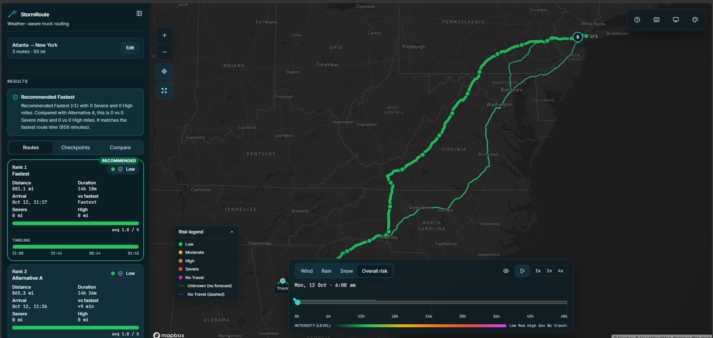
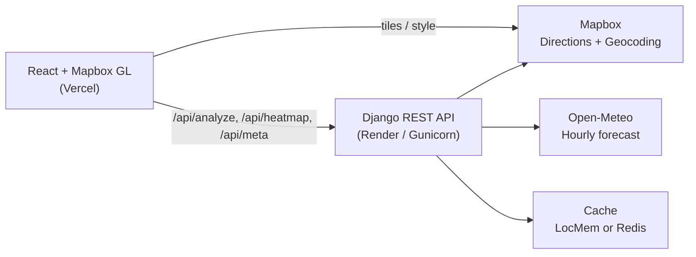

# StormRoute

**Weather-aware route planning for truck drivers — pick the safest path given wind, rain, snow, load weight, and travel time.**



| | |
|---|---|
| **Live demo** | _[placeholder — add Vercel URL]_ |
| **API** | _[placeholder — add Render URL]_ |
| **Walkthrough** | _[placeholder — add Loom URL]_ |

---

## What it does

Mapped to the assessment brief:

- Enter **origin**, **destination**, **departure date/time**, and **load weight** (lb).
- Generate up to **3 route options** via Mapbox Directions (with safe fallbacks when alternatives are scarce).
- Sample weather every **10 / 25 / 50 miles** (or auto by distance), using the truck’s **estimated arrival** at each checkpoint.
- Score **weather risk** from wind / rain / snow thresholds plus **load rules**.
- **Recommend** the best route: fewest Severe miles → fewest High → lowest average risk → shortest time.
- Show all routes, checkpoints, risk levels, ETAs, and summaries on a **full-bleed map**.
- Overlay a **0–48 hour weather heatmap** along the trip corridor with a forecast slider.

---

## Architecture



### `/api/analyze` request flow

1. **Validate** body (places, ISO-8601 departure with offset, load 0–200k lb, interval).
2. **Fetch routes** from Mapbox (`driving` + alternatives; overlap/duration filters; never fabricate).
3. **Sample checkpoints** along each geometry (auto interval or 10/25/50 mi); compute ETA per segment.
4. **Snap** lat/lng to 0.05°, dedupe, batch-fetch Open-Meteo hourly series; pick the **nearest hour** to each ETA; cache ~30 min.
5. **Assess risk** per checkpoint (`core/risk.py`), then **coverage miles** and metrics (`core/scoring.py`).
6. **Rank** routes with the D10 tuple; mark exactly one recommended unless all are blocked.
7. Return JSON: routes, checkpoints, metrics, recommendation, notices.

Domain logic lives in `backend/core/` with **no Django imports**. Views stay thin.

---

## How risk is calculated

Thresholds (D1) are evaluated on **unrounded** values. Lower bound inclusive where the brief table is ambiguous; rain exactly `1.00` in/hr and snow exactly `3.0` in/hr are **Severe** (No Travel is strictly greater).

| Condition | Low | Moderate | High | Severe | No Travel |
|-----------|-----|----------|------|--------|-----------|
| Wind (mph) | &lt;25 | 25–34 | 35–44 | 45–54 | ≥55 |
| Rain (in/hr) | &lt;0.10 | 0.10–0.25 | 0.25–0.50 | 0.50–1.00 | &gt;1.00 |
| Snow (in/hr) | &lt;0.5 | 0.5–1.0 | 1.0–2.0 | 2.0–3.0 | &gt;3.0 |

**Load rules (D2)** run after base classification and can only **raise** the level:

1. Wind ≥55 mph → **No Travel** for any load.
2. Wind 45–54 mph **and** load &gt;30,000 lb → **No Travel**.
3. Wind 35–44 mph **and** load &gt;40,000 lb → **Severe**.

Final checkpoint level = worst of wind / rain / snow after load rules (D3). Gusts are shown but not classified. Missing / out-of-range weather is **unknown**, never treated as Low (D5).

### Worked examples (from golden tests)

| Wind | Rain | Snow | Load (lb) | Final |
|------|------|------|-----------|-------|
| 24.9 | 0 | 0 | 80,000 | **Low** — under 25 mph; load rules do not apply |
| 45 | 0 | 0 | 30,001 | **No Travel** — Severe wind band + load &gt;30k |
| 35 | 0 | 0 | 40,001 | **Severe** — High wind band raised by load &gt;40k |

Full matrix: `backend/tests/test_risk.py` (`GOLDEN_CASES`). Thresholds are also exposed at `GET /api/meta` for the UI legend.

---

## How the recommendation works

Ranking key, **ascending** (D10):

```text
(has_no_travel, no_travel_miles, severe_miles, high_miles, avg_risk, duration)
```

Rounding for comparison only: miles → nearest 1 mi; `avg_risk` → 2 decimals; duration → nearest minute.

- Any **No Travel** mile marks the route **blocked**; blocked routes rank below every unblocked route.
- If **all** routes are blocked → `recommendation.route_id = null`, `all_blocked = true`, clear message.
- Explanation always states time cost vs the fastest route.

**Example** (`test_scenario_1_priority_order`): three 100 mi routes — A has Severe miles, B has High but no Severe, C has only Low/Moderate. Rank order is **C → B → A**; C is recommended even though it is 25 minutes slower than the fastest (B).

---

## Assumptions and limitations

Honest constraints baked into the product:

| Topic | Reality |
|-------|---------|
| Routing profile | Mapbox **`driving`** (car). Height / weight / hazmat truck restrictions are **not** modelled. |
| ETA | **Continuous driving** — no HOS breaks, rest stops, or live traffic. |
| Forecast horizon | Open-Meteo hourly window; ETAs &gt;30 min outside the series → `out_of_range`. Heatmap slider is 0–48 h from departure hour. |
| Weather grid | Coordinates snapped to **0.05°** and deduped (D12). |
| Wind | **Sustained** `wind_speed_10m` (mph). Gusts display-only. |
| Time slot | **Nearest** hourly forecast to checkpoint ETA. |
| Open-Meteo licence | Free for non-commercial research/education; **commercial use** needs a review of [Open-Meteo terms](https://open-meteo.com/en/terms) / a commercial plan. |
| Cache | Stateless API (D19): LocMem with **1×8 gthread** workers, or Redis if `REDIS_URL` is set. |

---

## Setup

### Prerequisites

- Python **3.12**, Node **22+**, npm
- Mapbox access token (Directions + Geocoding + GL styles)
- Optional: Redis, Docker / Docker Compose, Git Bash or WSL for `scripts/smoke_prod.sh`

### Environment variables

**Backend** (`backend/.env` — see `backend/.env.example`):

| Variable | Required | Notes |
|----------|----------|-------|
| `MAPBOX_TOKEN` | yes | Server-side Directions / Geocoding |
| `DJANGO_SECRET_KEY` / `SECRET_KEY` | yes (prod) | Prefer `DJANGO_SECRET_KEY` on Render |
| `DEBUG` | no | Default `false`; use `true` locally |
| `ALLOWED_HOSTS` | yes (prod) | Comma-separated hosts, e.g. `stormroute-api.onrender.com` |
| `CORS_ALLOWED_ORIGINS` | yes (prod) | **Exact** frontend origin only |
| `GEOCODE_COUNTRY` | no | Default `us` |
| `THROTTLE_RATE` | no | Default `60/min` (alias: `ANON_RATE_THROTTLE`) |
| `REDIS_URL` | no | Empty → LocMemCache |
| `SECURE_SSL_REDIRECT` | no | `true` behind HTTPS (Render) |
| `APP_VERSION` | no | Reported by `/api/health` |

**Frontend** (`frontend/.env` — see `frontend/.env.example`):

| Variable | Required | Notes |
|----------|----------|-------|
| `VITE_API_BASE_URL` | yes | e.g. `http://localhost:8000` or deployed API origin |
| `VITE_MAPBOX_TOKEN` | yes | Public token for Mapbox GL |

### Backend

```bash
python -m venv .venv
# Windows: .\.venv\Scripts\Activate.ps1
pip install -r backend/requirements.txt
cp backend/.env.example backend/.env   # set MAPBOX_TOKEN, DEBUG=true for local
cd backend && python manage.py runserver
# or: gunicorn config.wsgi:application -c gunicorn.conf.py
```

### Frontend

```bash
cp frontend/.env.example frontend/.env
cd frontend && npm ci && npm run dev
```

### Docker Compose

```bash
# Requires backend/.env with MAPBOX_TOKEN
export VITE_MAPBOX_TOKEN=pk....   # optional; compose passes through
docker compose up --build
```

- API: `http://localhost:8000` (`GET /api/health`)
- UI: `http://localhost:5173`

---

## Testing

```bash
# Backend (golden risk/scoring + API + properties)
cd backend
set DJANGO_TESTING=1          # Windows PowerShell: $env:DJANGO_TESTING=1
set MAPBOX_TOKEN=test-mapbox-token
pytest -q --cov=api --cov=core

# Frontend unit
cd frontend && npm run test -- --coverage

# Playwright e2e (mocked Mapbox style, no live map tiles)
cd frontend && npx playwright test

# Lint / types / build
cd backend && ruff check .
cd frontend && npm run lint && npm run typecheck && npm run build
```

**What the golden tests prove**

- `test_risk.py` — every boundary and load-rule row matches the brief (D1–D4).
- `test_scoring.py` — coverage miles sum to distance; ranking tuple, blocked routes, explanation text (D8–D10).
- Analyze / heatmap / weather client tests — wiring, caching snap, typed errors (no mock weather in product paths).

CI (`.github/workflows/ci.yml`) runs backend + frontend + Playwright, plus `pip-audit` and `npm audit`.

---

## Deployment

### Backend (Render)

1. Connect the repo; Blueprint uses [`render.yaml`](render.yaml) (Docker, health check `/api/health`).
2. Set secrets: `MAPBOX_TOKEN`, `ALLOWED_HOSTS`, `CORS_ALLOWED_ORIGINS` (exact Vercel origin), optional `REDIS_URL`.
3. Image runs **gunicorn** `--worker-class gthread --workers 1 --threads 8 --timeout 120` (shared in-process cache, D19). WhiteNoise serves static files. `DEBUG=false`; HSTS + secure cookies + `SECURE_PROXY_SSL_HEADER` enabled.

### Frontend (Vercel)

1. Root directory: `frontend`. Framework: Vite.
2. Env: `VITE_API_BASE_URL`, `VITE_MAPBOX_TOKEN`.
3. [`frontend/vercel.json`](frontend/vercel.json): SPA rewrite + security headers. **Content-Security-Policy is Report-Only** first (Mapbox + API hosts). Confirm the map works in production, then switch the header name to `Content-Security-Policy` to enforce.

### Production smoke + keep-warm

```bash
# Git Bash / WSL / Linux — requires curl + jq
API_BASE=https://YOUR-API.onrender.com ./scripts/smoke_prod.sh
```

Checks: `/api/health` ok; Denver→Boulder `/api/analyze` returns ≤3 routes; exactly one recommended unless `all_blocked`; `miles_by_level` sums to `distance_mi` within 0.01; checkpoint ETAs strictly increasing.

**Keep-warm (Render free tier):** ping `GET /api/health` every **5 minutes** (UptimeRobot, cron-job.org, GitHub scheduled workflow, etc.) so the single worker stays hot and LocMem weather cache is useful between requests.

---

## Project structure

```text
StormRoute/
├── backend/
│   ├── api/           # DRF views, serializers, typed errors
│   ├── core/          # Pure domain: risk, scoring, routes, weather, heatmap
│   ├── config/        # Django settings, URLs, WSGI
│   ├── tests/         # pytest goldens + properties
│   ├── Dockerfile
│   └── gunicorn.conf.py
├── frontend/
│   ├── src/           # React app, map layers, planner UI
│   ├── e2e/           # Playwright (mocked)
│   └── vercel.json
├── docs/              # DECISIONS, API, ARCHITECTURE
├── scripts/smoke_prod.sh
├── render.yaml
├── docker-compose.yml
└── .github/workflows/ci.yml
```

---

## Trade-offs and future work

| Done now | Future |
|----------|--------|
| Car `driving` profile + documented truck gap | True **truck** routing (restrictions, axle, hazmat) |
| Continuous-driving ETA | **Hours-of-service** break model |
| Static Mapbox duration | **Live traffic** / departure-time optimiser |
| In-app risk snapshot | Push / SMS **alerts** when a corridor deteriorates |
| CSP Report-Only | Enforce CSP after production violation review |

Prioritised correctness of risk + recommendation and map UX over extra features — matching the evaluation rubric (40% logic, 35% UI/map).
